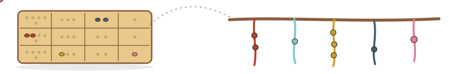
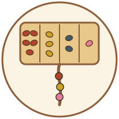

<p align="center">
  
</p>

<p align="center">
  
</p>

<h1 align="center">seeds</h1>

<p align="center">
  <em>🫘 Track agent work as facts in a knowledge graph, and pin any item to any moment</em>
</p>

<p align="center">
  <a href="LICENSE"></a>
  <a href="https://github.com/scbrown/seeds/actions/workflows/ci.yml"></a>
  <a href="https://github.com/scbrown/caboodle"></a>
</p>

**seeds is an issue tracker for AI coding agents that stores each work item as
facts in a [quipu](https://github.com/scbrown/quipu) knowledge graph instead of
rows in a versioned database. It is a CLI that answers the `bd`/`br` verbs
agents already type (`create`, `show`, `ready`, `close`, …) with `--json` in the
same shape, and it is the beads replacement for the quipu stack.** The
name comes from the counting board: a *quipucamayoc* moved seeds across a
*yupana* to count, then knotted the result into the quipu.

## Why you would want it

- **Pin one item, not the whole database.** Every write is a quipu transaction,
  so `--at <tx>` resolves a single seed as it stood then, while the project
  keeps moving.
- **No commit step, no server to babysit.** The transaction id is the cursor;
  there is no dirty state, no garbage collection and no SQL server lifecycle.
- **Share a ledger like a package.** A project is one named graph, and a quipu
  pendant carries it and its shapes to another team. Use `sd export` and
  `sd import`; remote export is unpinned (see [Storage modes](docs/book/src/storage-modes.md)).

The full case, and exactly what it is and is not:
[Introduction](docs/book/src/introduction.md).

Explicit remote `search --full` uses a prepared optional substring index; see
[full-field search](docs/book/src/full-field-search.md) for its refusal contract.

## Install

**Debian and Ubuntu (amd64 and arm64):** install from the signed apt repository, which
republishes each checksum-verified release. The package puts `sd` in
`/usr/bin`. Check the signing key's fingerprint before trusting it; the
commands stop if it does not match:

```bash
curl -fsSL https://scbrown.github.io/apt/key.gpg -o scbrown-stack.gpg
gpg --show-keys --with-colons scbrown-stack.gpg \
  | grep -qx 'fpr:::::::::AB5625C5612F643BF76464DF0DC99924994EC959:' \
  && sudo install -D -m 0644 scbrown-stack.gpg /etc/apt/keyrings/scbrown-stack.gpg \
  && echo "deb [signed-by=/etc/apt/keyrings/scbrown-stack.gpg] https://scbrown.github.io/apt stable main" \
     | sudo tee /etc/apt/sources.list.d/scbrown-stack.list \
  && sudo apt update && sudo apt install seeds
```

`apt upgrade` then picks up new releases. unattended-upgrades only installs
from origins it allows, so to have it upgrade seeds too, add
`"origin=scbrown,codename=stable";` to `Unattended-Upgrade::Origins-Pattern`.
Channels, pinning and rollback:
[scbrown/apt](https://github.com/scbrown/apt#channels-and-pinning).

The command is `sd`; the project and crate are **seeds** / `seeds-ai`.
Prebuilt `sd` binaries for Linux x86_64/arm64 and macOS arm64/x86_64 are
attached to each [GitHub release](https://github.com/scbrown/seeds/releases)
(tags `seeds-ai-v<version>`), with a `SHA256SUMS.txt`.

```bash
V=seeds-ai-v0.2.4 T=x86_64-unknown-linux-gnu   # or aarch64-unknown-linux-gnu, aarch64-apple-darwin, x86_64-apple-darwin
curl -fsSLO "https://github.com/scbrown/seeds/releases/download/$V/sd-$V-$T.tar.gz"
curl -fsSLO "https://github.com/scbrown/seeds/releases/download/$V/SHA256SUMS.txt"
sha256sum --ignore-missing -c SHA256SUMS.txt     # macOS: shasum -a 256 --ignore-missing -c SHA256SUMS.txt
mkdir -p ~/.local/bin
tar xzf "sd-$V-$T.tar.gz" && install "sd-$V-$T/sd" ~/.local/bin/
```

Or from crates.io, once the first version is published (needs Rust 1.89+):

```bash
cargo install seeds-ai --locked
```

Check it:

```bash
sd --version
```

```text
sd 0.2.4 (seeds)
```

**Already have `sd`?** [chmln/sd](https://github.com/chmln/sd), the popular
find-and-replace tool, also installs a command called `sd` (crates.io `sd`,
Homebrew `sd`). The two cannot share a name on your `PATH`:

- `cargo install seeds-ai` refuses to overwrite an existing `~/.cargo/bin/sd`.
  `--force` replaces it, which removes chmln/sd from that location.
- If both are installed in different directories, `PATH` order decides which
  `sd` runs. `which -a sd` lists them in that order.
- To keep both, install the prebuilt binary under another name, for example
  `install "sd-$V-$T/sd" ~/.local/bin/seeds`, and use that name (and
  `dp alias --cmd bd --replace seeds`).

If `sd --version` prints anything other than `sd <version>`, you are running
a different `sd`.

## First success in three commands

No server and no configuration: the first write creates a local quipu store at
`.seeds/seeds.db`.

```bash
sd create "Write the parser" -p 1
sd ready --json
echo "exit $?"
```

```text
created ○ sd-k2x [P1] [task] Write the parser (tx 1)
[{"assignee":null, … ,"id":"sd-k2x","issue_type":"task", … ,"priority":1,"revision":1,"status":"open","title":"Write the parser", … }]
exit 0
```

## On your own code

| you want to… | run |
|---|---|
| see what is ready to work on (never silently truncated) | `sd ready --json` |
| open a work item | `sd create "title" -p 1 -t task` |
| claim it (exactly one caller wins; the rest exit 4) | `sd update <id> --claim` |
| record that one blocks another | `sd dep add <id> <depends-on>` |
| close it, saying what landed | `sd close <id> --reason "…"` |
| read an item as it was | `sd show <id> --at <tx>` |

Every verb, flag and exit code: [Reference](docs/book/src/reference.md). Where
the store lives and how to point it elsewhere:
[Configuration](docs/book/src/config.md).

## Where the ledger lives

| mode | config | you get |
|---|---|---|
| local (default) | nothing | a quipu store at `.seeds/seeds.db` |
| repo-local pendant | `[pendant] dir = ".seeds/pendant"` | the ledger committed with your code, as quipu's share files; clone the repo and you have the board, and a git merge driver merges branches field by field |
| remote | `[quipu] url = "https://…"` | a shared quipu server, read and written live |
| sync | a local store plus `[sync] remote = "https://…"` | `sd sync`: a three-way merge both ways; conflicts are listed, never resolved by last-writer-wins |

Details: [Storage modes](docs/book/src/storage-modes.md).

## Formulas

Workflow templates that stamp and drive chains of work items (beads'
molecules) are [shuttle](https://github.com/scbrown/shuttle)'s job, not a
second engine inside seeds. Today a seed can record the shuttle run that
drives it (`--workflow-run`); the integration is the next step:
[Formulas](docs/book/src/formulas.md).

## Wire it into your agent

Agents keep typing `bd`. [desire-path](https://github.com/scbrown/desire-path)
rewrites that to seeds before the tool call runs:

```bash
dp alias --cmd bd --replace sd
```

[caboodle](https://github.com/scbrown/caboodle) sets this alias for you when a
plan installs both seeds and desire-path. If the host already has a `bd` alias
that points somewhere else, caboodle leaves it alone and reports it, because
`dp alias` would otherwise replace it silently. Run the command above by hand
only if you install seeds without caboodle.

A `bd` verb seeds rejects is recorded, so `dp paths` becomes the seeds backlog.
seeds embeds
quipu as a library: every write is one quipu transaction in the project's
named graph, a `schema:Action` validated against the seeds profile. How the pieces fit:
[Architecture](docs/book/src/architecture.md) and
[The storage model](docs/book/src/storage.md).

The core (verbs, ready, JSON) also builds for WebAssembly:
[WebAssembly](docs/book/src/wasm.md).

## Before you start

| | Linux x86_64 | macOS arm64 | macOS x86_64 | Linux arm64 |
|---|---|---|---|---|
| seeds | release | release | release | release |

Rust 1.89 or newer to build from source. No quipu server needed: the store is a
local file by default. A shared quipu server over HTTP is also supported
(`--quipu <url>`, and `sd sync` between the two; [What is built](docs/book/src/status.md)).

## What's next

- [The seeds book](docs/book/src/introduction.md): start here to go deeper
- [Docs map](docs/book/src/docs-map.md): every document in this repo, routed
- [The bd intent map](docs/book/src/intent-map.md): what seeds must provide, and what goes away
- [What is built, and what is not](docs/book/src/status.md)

## 🧺 The stack

Caboodle installs these together and proves each one works; every tool also stands alone.

<!-- stack-table:start -->

The Quipu stack is built around a governed, bitemporal knowledge store: shared
facts, decisions and work history your agents can query. Quipu can check writes
against your rules, records where each fact came from, and answers what was true
when.

| tool | what it gives your agents |
|---|---|
| [caboodle](https://github.com/scbrown/caboodle) | 🧰 Agent Platform Toolkit - installs and configures the quipu stack |
| [quipu](https://github.com/scbrown/quipu) | stores shared facts with provenance and history; can check writes against your rules |
| [camayoc](https://github.com/scbrown/camayoc) | prepares knowledge and vocabulary for Quipu, with checks before it is admitted |
| [bobbin](https://github.com/scbrown/bobbin) | searches your code and can include related knowledge from Quipu |
| [yupana](https://github.com/scbrown/yupana) | shows code impact and can read policies from Quipu to check changes |
| [desire-path](https://github.com/scbrown/desire-path) | turns agent mistakes into feature requests; works on its own without Quipu |
| [seeds](https://github.com/scbrown/seeds) | a work item tracker backed by the Quipu knowledge base |
| [shantytown](https://github.com/scbrown/shantytown) | runs crews of AI agents on work items, triggered by hand, on a schedule or by events; can share work and memory through Quipu |
| [shuttle](https://github.com/scbrown/shuttle) | runs signed agent workflows and keeps their records in Quipu |

<!-- stack-table:end -->

seeds is the stack's work tracker, built on the others: quipu stores it,
camayoc supplies its governance terms and constraints, caboodle installs and
verifies it, and desire-path redirects `bd` to it.
[How seeds fits the stack](docs/book/src/stack.md).

## Contributing

```bash
just build
just test
just ci      # what CI runs
```

## 📜 License

[MIT](LICENSE)

<p align="center">
  
</p>
